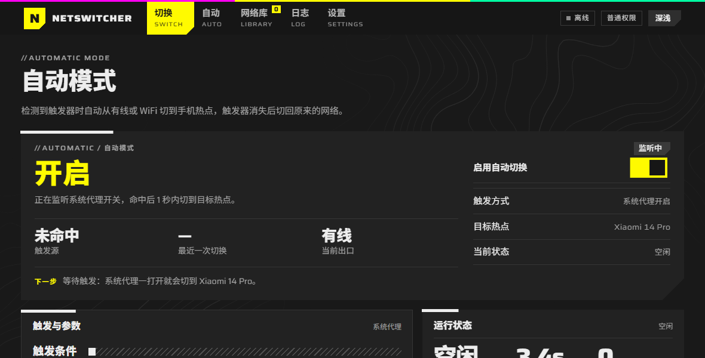

# NetSwitcher

Windows 网络切换工具：在**有线 / WiFi / 手机热点**之间一键切换；系统代理一开就自动切到手机热点，关了自动切回。

**v1.0.0** · Windows 10 / 11 · MIT

## 主要功能

- **一键切换**：有线 / WiFi / 手机热点三个目标，走硬断（禁用网卡 / `wlan disconnect`）
- **失败自动回滚**：每一步都实测（拿到 IPv4 + 外网 TCP 探活），失败退回原网络；
  切换前写事务快照，程序被强杀下次启动能提示还原
- **自动模式**：两种触发可切换——**系统代理被开启**、**代理软件进程出现**；
  带防抖、幂等、失败冷却、手动优先（手动切过就让路，之后才出现的触发照常接管）
- **网络库**：保存 SSID / 密码（Windows DPAPI 加密，落盘无明文）/ 类型 / 自动目标；
  可改密码并同步写回系统 WiFi 配置；连上过的网络自动收录
- **过程可见**：状态机 8 态、事件时间线、界面内日志 + 按天落盘

## 下载

- **NetSwitcher-1.0.0-Setup.exe** —— 安装版，图形化向导，装完出现在「应用和功能」里
- **NetSwitcher-1.0.0-Portable.zip** —— 免安装，解压即用

启动会弹一次 UAC —— 启停网卡必须有管理员权限。首次运行若提示「未知发布者」，点「更多信息 → 仍要运行」。

## 说明

- 只改变出口链路，不保证流量不被识别（DHCP 指纹、TLS SNI、流量特征仍在）
- 切换会短暂断网（1~8 秒），下载和长连接会中断
- 请遵守所在学校或单位的网络管理规定

## 许可

[MIT](LICENSE)。界面用的 Saira 字体为 SIL OFL，授权文本见 `frontend/renderer/vendor/fonts/Saira-OFL.txt`。
